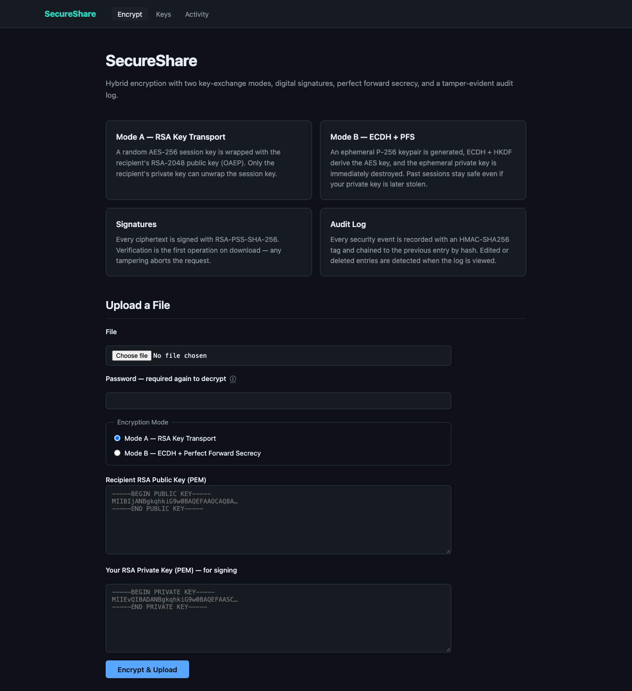

# SecureShare


[](https://github.com/Evanildo22/CRYPTOGRAPHY/actions/workflows/tests.yml)
[](LICENSE)

SecureShare is a Flask web application that demonstrates applied cryptography end to end. Files are encrypted before storage, every ciphertext is signed to prove who uploaded it, and every security event is written to a tamper-evident audit log.

It offers two encryption modes: RSA key transport, and ECDH with perfect forward secrecy (the mechanism behind TLS 1.3 and Signal). The same upload pipeline therefore shows both how traditional public-key encryption works and what ephemeral key agreement adds.

Every primitive is wired into the running application and covered by 100 tests that verify tamper detection, round-trip correctness through the web routes, and the no-disk-write guarantee for ephemeral keys.



> **Threat model:** [`THREAT_MODEL.md`](THREAT_MODEL.md) covers assets, seven adversary profiles, attack trees for each threat, mitigations with residual risks, and an explicit list of what this system does *not* protect against.

---

## Security Goals

| Goal | Mechanism |
|---|---|
| **Confidentiality** | AES-256-GCM — the file key is derived from both the session key and a password, so decryption needs the recipient's private key *and* the password |
| **Integrity** | GCM 128-bit auth tag — any ciphertext modification raises `InvalidTag` before plaintext is released |
| **Authenticity** | RSA-PSS-SHA256 over ciphertext — verified before decryption; wrong key or tampered bytes abort the request |
| **Forward Secrecy** | ECDH P-256 ephemeral keypair — private key destroyed after derivation; past sessions safe after long-term key compromise (Mode B) |
| **Non-repudiation** | HMAC-SHA256 + SHA-256 hash chain append-only audit log — every upload, download, and verification attempt is recorded; modified entries are flagged per-row via HMAC, deleted entries are detected via the hash chain and reported in a summary banner |

---

## Architecture

```
┌─────────────────────────────────────────────────────────────────────────┐
│                        CLIENT  (browser)                                │
│  Pastes keys → form POST over HTTPS → keys exist in server RAM only     │
└──────────────────────────────────┬──────────────────────────────────────┘
                                   │ HTTPS  (enforce via reverse proxy)
┌──────────────────────────────────▼──────────────────────────────────────┐
│                        FLASK APPLICATION  (app.py)                      │
│                                                                         │
│  /upload                          /download/<id>         /audit         │
│    │                                │                      │            │
│    ▼                                ▼                      ▼            │
│  crypto/kdf.py              crypto/signatures.py     audit/log.py       │
│  PBKDF2 → password key      RSA-PSS verify first     HMAC re-verify     │
│    │                                │                                   │
│    ├── Mode A ──────────────────────┤                                   │
│    │   crypto/rsa_keys.py           │                                   │
│    │   random AES key               │                                   │
│    │   RSA-OAEP wrap ───────────────┤                                   │
│    │                                │                                   │
│    └── Mode B ──────────────────────┤                                   │
│        crypto/pfs.py                │                                   │
│        ephemeral P-256 keygen       │                                   │
│        crypto/ecdh.py HKDF ─────────┤                                   │
│        zero + discard priv key      │                                   │
│            │                        │                                   │
│            ▼                        ▼                                   │
│        crypto/aes.py            crypto/aes.py                           │
│        AES-256-GCM encrypt      AES-256-GCM decrypt                     │
│            │                        │                                   │
│            ▼                        ▼                                   │
│        crypto/signatures.py     crypto/fingerprint.py                   │
│        RSA-PSS sign              SHA-256 recompute + compare            │
│            │                                                            │
│            ▼                                                            │
│        audit/log.py  ← HMAC-SHA256 entry appended after every event     │
└──────────────────────────────────┬──────────────────────────────────────┘
                                   │ local filesystem
┌──────────────────────────────────▼──────────────────────────────────────┐
│                   STORAGE  (assume adversary can read)                  │
│                                                                         │
│  storage/files/*.enc          AES-256-GCM ciphertext blobs              │
│  storage/keys/*.key           RSA-OAEP wrapped session keys (Mode A)    │
│  storage/keys/*.ecpub         Ephemeral EC public keys  (Mode B)        │
│  storage/sigs/*.sig           RSA-PSS signatures                        │
│  storage/fingerprints/*.sha256  SHA-256 plaintext digests               │
│  storage/audit/audit.log      HMAC-signed append-only event log         │
└─────────────────────────────────────────────────────────────────────────┘
```

### Upload flow

```
File + Password + Mode
       │
       ├─ PBKDF2-HMAC-SHA256 (600k iter, 128-bit salt) ──► password key
       ├─ SHA-256 fingerprint of plaintext stored for post-decrypt verify
       │
       ├─ Mode A: generate random 256-bit session key
       │          RSA-OAEP wrap with recipient public key → .key
       │
       ├─ Mode B: ephemeral P-256 keygen  (crypto/pfs.py)
       │          ECDH + HKDF-SHA256 → 256-bit session key
       │          ephemeral private key zeroed + discarded immediately
       │          ephemeral public key stored → .ecpub
       │
       ├─ HKDF-SHA256(session key ‖ password key) ──► file key
       ├─ AES-256-GCM encrypt plaintext with file key → .enc  (tag prepended for early rejection)
       ├─ RSA-PSS-SHA256 sign ciphertext → .sig
       └─ HMAC-SHA256 audit log entry appended
```

### Download flow

```
File ID + Keys + Password
       │
       ├─ RSA-PSS verify signature  ──► ABORT on InvalidSignature (before any decryption)
       │
       ├─ Mode A: RSA-OAEP unwrap .key → session key
       ├─ Mode B: ECDH (recipient static priv + stored .ecpub) + HKDF → session key
       │
       ├─ PBKDF2 (password + stored salt) → password key
       ├─ HKDF-SHA256(session key ‖ password key) ──► file key
       ├─ AES-256-GCM decrypt  ──► ABORT on InvalidTag (any ciphertext tampering)
       ├─ SHA-256 recompute + compare to stored fingerprint
       └─ HMAC-SHA256 audit log entry appended
```

---

## Cryptographic Primitives

| Module | Primitive | Standard | Why this choice |
|---|---|---|---|
| `crypto/aes.py` | AES-256-GCM | NIST SP 800-38D | AEAD: confidentiality + integrity in one pass; 128-bit auth tag is inseparable from decryption |
| `crypto/rsa_keys.py` | RSA-2048 OAEP | RFC 8017 | OAEP is IND-CCA2 secure; PKCS#1 v1.5 is vulnerable to Bleichenbacher 1998 |
| `crypto/ecdh.py` | ECDH P-256 + HKDF-SHA256 | RFC 5869 | Raw ECDH output is a curve point, not uniform random; HKDF extracts + expands to a proper key |
| `crypto/pfs.py` | Ephemeral key lifecycle | TLS 1.3 §4.2.8 | Private key zeroed via `ctypes.memset` immediately after HKDF; never written to disk |
| `crypto/signatures.py` | RSA-PSS-SHA256 | RFC 8017 §9.1 | Encrypt-then-sign ordering (the signature covers the ciphertext); `PSS.MAX_LENGTH` salt (32 B) maximises security margin |
| `crypto/kdf.py` | PBKDF2-HMAC-SHA256, HKDF-SHA256 combiner | NIST SP 800-132, RFC 5869 | 600k iterations (2023 minimum); 128-bit random salt per derivation. The password key is combined with the session key, so a stolen private key alone does not decrypt a file |
| `crypto/fingerprint.py` | SHA-256 | FIPS 180-4 | Collision-resistant commitment to plaintext; compatible with `sha256sum` for out-of-band verify |
| `audit/log.py` | HMAC-SHA256 + SHA-256 hash chain | RFC 2104 | Hybrid approach: per-entry HMAC flags modified rows as TAMPERED; `prev_hash` chain detects deletions and surfaces them as a summary banner, avoiding cascade noise on unmodified rows |

---

## Quickstart

**Prerequisites:** Python 3.11+, pip

```bash
git clone https://github.com/Evanildo22/CRYPTOGRAPHY.git
cd CRYPTOGRAPHY
pip install -r requirements.txt
```

```bash
# Generate secrets (do this once; store in a .env file, never commit)
export AUDIT_LOG_KEY=$(python3 -c "import secrets; print(secrets.token_hex(32))")
export FLASK_SECRET_KEY=$(python3 -c "import secrets; print(secrets.token_hex(32))")

python3 app.py
# → http://127.0.0.1:5000
```

**Workflow:**

1. **`/keys`** — Generate RSA-2048 and P-256 EC keypairs. Use the **Copy** or **Download** buttons next to each key; the server never stores private keys.
2. **`/` (Upload)** — Choose Mode A (RSA) or Mode B (ECDH+PFS), paste the recipient's public key and the sender's signing private key, set a password, then upload a file.
3. **`/download/<id>`** — Paste the matching private key and enter the upload password; the app verifies the signature, decrypts, checks the fingerprint, and serves the file. A success banner confirms that signature verification passed before the download starts.
4. **`/audit`** (Activity) — Every event is listed with its integrity status. Successful and failed attempts (signature failures, wrong keys) are all recorded. Modified entries are flagged as TAMPERED on the row; deletions break the hash chain and are reported in a summary banner without cascading noise into individual rows.

### Run tests

```bash
pytest tests/ -m "not benchmark" -v   # 100 tests, ~10s
pytest tests/test_aes.py -m benchmark -v -s   # 6 throughput benchmarks (1/10/100 MiB)
```

---

## Project Structure

```
CRYPTOGRAPHY/
├── app.py                   Flask routes: upload, download, verify, keys, audit
├── config.py                Single source of truth for all security constants
├── requirements.txt         Pinned dependencies (supply chain hygiene)
├── THREAT_MODEL.md          Adversary profiles, attack trees, residual risks
├── LICENSE                  MIT
├── CHANGELOG.md             Version history
│
├── crypto/
│   ├── aes.py               AES-256-GCM  —  encrypt / decrypt
│   ├── rsa_keys.py          RSA-2048     —  keypair gen, OAEP wrap / unwrap
│   ├── ecdh.py              P-256        —  ephemeral keygen, ECDH + HKDF
│   ├── pfs.py               PFS          —  ephemeral key lifecycle + zeroisation
│   ├── signatures.py        RSA-PSS      —  sign / verify over ciphertext
│   ├── kdf.py               PBKDF2       —  password key + file-key combiner
│   └── fingerprint.py       SHA-256      —  plaintext commitment + verify
│
├── audit/
│   └── log.py               HMAC-SHA256 + hash-chained append-only audit log
│
├── storage/                 Encrypted artefacts (never plaintext)
├── templates/               Jinja2 HTML templates
├── static/                  CSS + JS
├── docs/                    README screenshot
├── demo/                    Terminal walkthrough of the full pipeline
└── tests/                   100 tests + 6 AES throughput benchmarks
```

---

## Tests

Each module has a dedicated test file, and `test_app.py` drives the full upload and download flow through the Flask routes. Tests verify both the happy path and failure modes.

| File | What is tested |
|---|---|
| `tests/test_aes.py` | Round-trip, per-call IV uniqueness, bit-flip detection in tag / IV / body, key-length validation; benchmarks (`-m benchmark`): encrypt/decrypt throughput for 1/10/100 MiB |
| `tests/test_rsa.py` | Keypair generation, PEM round-trip, OAEP wrap/unwrap, non-determinism, wrong-key rejection |
| `tests/test_ecdh.py` | Both-sides-agree, output length, HKDF determinism, different-salt isolation, PEM round-trip |
| `tests/test_pfs.py` | Session key length, recipient reproduction, independent exchanges, **no disk writes during exchange** |
| `tests/test_signatures.py` | Valid signature passes, tampered ciphertext aborts, wrong key aborts, PSS non-determinism |
| `tests/test_kdf.py` | Output length, determinism, salt uniqueness, string/bytes equivalence, Unicode passwords; file key changes if either the session key or the password key changes |
| `tests/test_fingerprint.py` | Known SHA-256 vectors, single-bit sensitivity, constant-time comparison, case insensitivity |
| `tests/test_audit.py` | Append + read, HMAC verification, field tamper detection, deletion detection, extra-field invalidation |
| `tests/test_app.py` | End-to-end round trip in both modes; wrong password fails with the right private key; wrong private key fails with the right password; failures are audit-logged |

---

## Dependencies

```
cryptography==42.0.5    # AEAD, RSA, ECDH, HKDF, KDF — PyCA's audited library
Flask==3.0.3            # Web framework
pytest==8.2.0           # Unit testing
python-dotenv==1.0.1    # .env loading
```

Versions are pinned to prevent silent upgrades that could introduce vulnerabilities. See [NIST SP 800-218 §2.5](https://doi.org/10.6028/NIST.SP.800-218) on software supply chain hygiene.

---

## What Happens If This Is Implemented Incorrectly

Every decision in this codebase has a specific failure mode if made differently. These are the four most consequential ones.

---

### 1. Using ECB mode instead of GCM

AES-ECB (Electronic Codebook) encrypts each 16-byte block independently with the same key. The consequence is structural: identical plaintext blocks produce identical ciphertext blocks. The encrypted output leaks the pattern of the underlying data.

The canonical demonstration is the ECB penguin, encrypting a bitmap image with AES-ECB produces ciphertext that still visibly resembles the original image because uniform regions of pixels encrypt to uniform regions of ciphertext.

In a file-sharing context, an attacker who intercepts two ciphertext files can determine whether they share any 16-byte-aligned blocks, revealing partial content, structural similarity, or duplicate uploads without breaking the key.

ECB also provides no authentication. An attacker can rearrange, delete, or splice ciphertext blocks and the recipient has no way to detect the modification.

**What this project does instead:** AES-256-GCM. The authentication tag is computed over the entire ciphertext using a polynomial MAC (GHASH). Any modification to any byte, including reordering blocks — produces a tag mismatch. Decryption raises `InvalidTag` before returning a single plaintext byte. The mode also chains block outputs through a counter, so identical plaintext blocks encrypt to different ciphertext blocks.

---

### 2. Reusing an IV under the same key

AES-GCM's security guarantee collapses completely when an IV is reused with the same key. This is not a gradual degradation, it is a catastrophic failure.

GCM uses the IV to initialise a keystream (CTR mode). If two messages are encrypted with the same key and IV, their keystreams are identical. An attacker who observes both ciphertexts `C1 = P1 ⊕ K` and `C2 = P2 ⊕ K` can compute `C1 ⊕ C2 = P1 ⊕ P2`. XOR-ing two plaintext streams is recoverable via known-plaintext or crib-dragging attacks — the attacker does not need the key.

IV reuse also breaks authentication. The GHASH key for GCM is derived from `AES(key, IV)`. If the same IV is reused, the attacker can recover the GHASH key by solving a polynomial equation over GF(2^128) from two observed (ciphertext, tag) pairs. Once they have the GHASH key they can forge authentication tags for arbitrary messages under that key-IV pair, completely defeating the integrity guarantee.

This is not hypothetical. Böck et al. ("Nonce-Disrespecting Adversaries", 2016) found public HTTPS servers that repeated AES-GCM nonces and showed practical forgery attacks against them, and KRACK (2017) broke WPA2 by forcing clients to reinstall a key and reuse nonces.

**What this project does instead:** `os.urandom(12)` is called inside `aes.encrypt()` on every invocation, the IV is never accepted as a parameter from the caller. The random IV is stored alongside the ciphertext so the recipient can decrypt, but the caller has no way to accidentally or deliberately reuse it. The test `test_different_ivs_per_call` asserts that two encryptions of the same plaintext produce different IVs.

---

### 3. Skipping signature verification before decryption

If signature verification is optional, deferred, or performed after decryption, the system loses its authenticity guarantee.

The GCM tag only proves that a ciphertext was produced by someone who knew the session key. In both modes that key is established against the recipient's *public* key, so anyone with write access to storage can encrypt a file of their choosing, replace the stored artefacts, and GCM will accept the result as valid. Only the signature binds the stored blob to the uploader's private key. Without it, the recipient cannot tell whether a file came from the claimed sender or was substituted.

Verifying first also means no key unwrapping or decryption work is ever done on unauthenticated input. Every forged request fails at the same point and in the same way, which removes the opportunity to learn anything from differences in error messages or timing further down the pipeline.

**What this project does instead:** In `app.py`'s download route, `signatures.verify_ciphertext()` is called first, before any key material is loaded or any decryption attempt is made. If it raises `InvalidSignature`, the request is aborted and the event is logged as `VERIFY_FAIL`. The decryption code is unreachable without a valid signature. The test `test_tampered_ciphertext_body_raises` verifies that a single-bit flip in the ciphertext fails the signature check.

---

### 4. Hardcoding keys or deriving them from a constant

Hardcoded keys are the most common cryptographic mistake in real codebases and the easiest to find, a `git log` search or a `grep` for hex strings often surfaces them immediately.

The failure modes are layered. A key committed to a repository is in every clone, every fork, every CI log that prints environment variables, and every backup. Rotating it requires a code change and redeploy. Any file encrypted with it before the rotation can be decrypted by anyone who ever had a copy of the repository.

A subtler variant is deriving the key deterministically from a low-entropy source: `hashlib.sha256(b"my-app-secret")` produces the same 32 bytes on every run, giving the appearance of a proper key while providing none of the security. An attacker who knows the application name, the framework, or who simply tries common patterns can recover the key without access to any secret material.

The same problem applies to using a constant salt in PBKDF2. Without a random per-derivation salt, two users with the same password get the same derived key. An attacker can precompute a rainbow table over the fixed salt and crack all passwords simultaneously rather than one at a time.

**What this project does instead:** The session key is either `os.urandom(32)` (Mode A) or derived from a fresh ephemeral ECDH exchange (Mode B) — neither path has a constant — and the file key is derived from it together with the password key. The PBKDF2 salt is `os.urandom(16)` inside `kdf.derive_key()`, generated on every call unless the caller explicitly passes a stored salt for reproduction. The audit log HMAC key is loaded from the `AUDIT_LOG_KEY` environment variable with no in-code default that would work in production. The `config.py` default of `"0" * 64` is visually conspicuous — all zeros is an obvious placeholder, not a functioning key — and the comment explicitly marks it as requiring an override.

---

## Known Limitations

This project is a cryptography demonstration, not a production system. The following gaps are documented honestly in [`THREAT_MODEL.md §7`](THREAT_MODEL.md#7-what-this-system-does-not-protect-against):

- **No post-quantum security** — RSA and ECDH are broken by Shor's algorithm. NIST PQC replacements: CRYSTALS-Kyber (KEM), CRYSTALS-Dilithium (signatures).
- **PBKDF2 not memory-hard** — Argon2id is strictly superior for password hashing; PBKDF2 is GPU-parallelisable. Used here as the well-known baseline.
- **No HSM** — Private keys pass through application RAM. A production system would use a hardware security module or cloud KMS.
- **Mode A has no forward secrecy** — Long-term RSA key compromise retroactively exposes all Mode A sessions.
- **No HTTPS enforcement** — Deploy behind nginx or Caddy in production.
- **Metadata leakage** — File size, access timing, and IP addresses are not concealed.
- **No user authentication** — Any client can upload. Production requires authn/authz.

---

## Environment Variables

| Variable | Required | Description |
|---|---|---|
| `AUDIT_LOG_KEY` | Yes | 64-char hex (32-byte) HMAC key for audit log integrity |
| `FLASK_SECRET_KEY` | Yes | 64-char hex Flask session signing key |
| `FLASK_DEBUG` | Recommended | Set to `0` in production; `1` only for local development |

Copy [`.env.example`](.env.example) to `.env` and fill in real values. **Never commit `.env`.**
